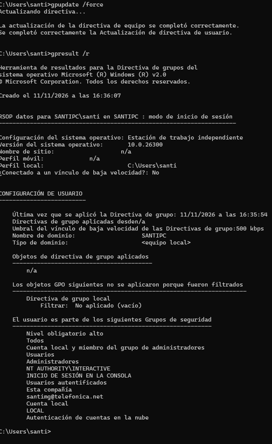
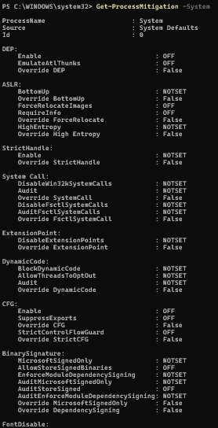
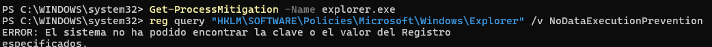
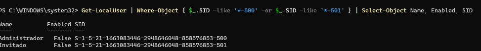
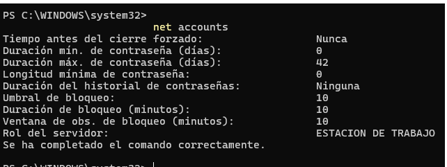
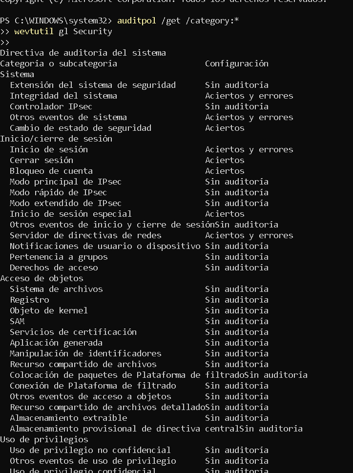
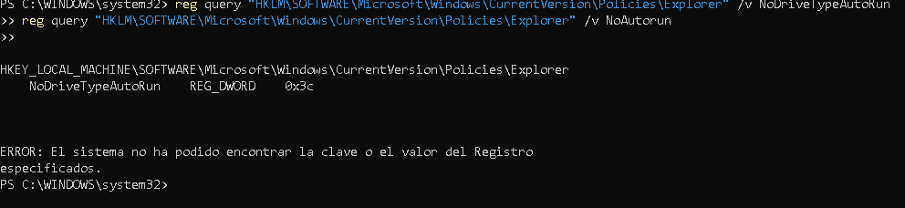
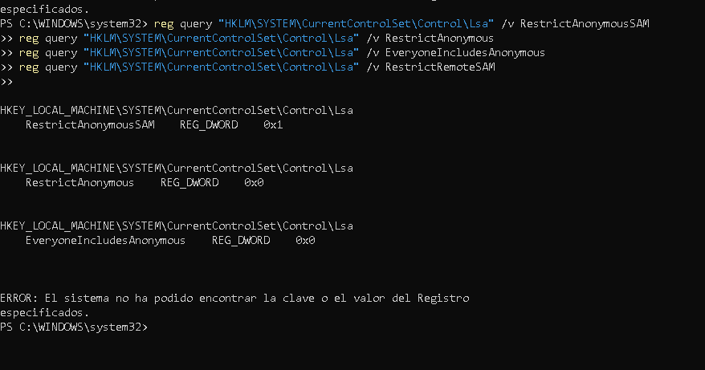

#  Operación Templo de Massassi: Informe de Bastionado de Windows 11
**Entorno:** Base Rebelde de Yavin 4 · Dominio de Red Rebelde  
**Módulo:** Bastionado de Redes y Sistemas (Hardening Windows)  
**Autor/a:** Responsable de Bastionado de la Alianza Rebelde  
**Fecha:** 2026  

---

##  1. Introducción y Objetivos
Ante la amenaza inminente de la inteligencia del Imperio Galáctico, la Alianza Rebelde ha ejecutado un plan de bastionado integral (*hardening*) sobre las estaciones de trabajo Windows 11 desplegadas en el Gran Templo de Massassi. 

Los objetivos estratégicos de este documento consisten en:
* Interpretar y configurar adecuadamente las directivas de grupo escritas con nomenclatura en negativo.
* Mitigar vectores de ataque físicos, de red, de movimiento lateral y de ejecución maliciosa mediante GPO (*Group Policy Objects*) y `secpol.msc`.
* Evaluar el impacto operacional que cada medida impone a los pilotos y personal técnico de la base.
* Validar la correcta aplicación de los controles de seguridad mediante la línea de comandos de Windows (PowerShell / CMD).

---

##  Parte 1 · Razonamiento: Directivas en negativo y valores

### 1. Prevenir la desactivación de DEP en el Explorador
* **Respuesta:** **b) Deshabilitada**
* **Justificación:** La directiva se titula *«Desactivar la prevención de ejecución de datos para el Explorador»*. Si se establece en *Habilitada*, la protección DEP se apaga. Para mantener DEP activa en `explorer.exe`, la directiva debe estar **Deshabilitada** (o no configurada, manteniéndose por defecto activa).

### 2. Protección en inicio de sesión (Contraseña de imagen y PIN cómodo)
* **Respuesta:** **a) «Desactivar inicio de sesión con contraseña de imagen»: Habilitado y «Activar inicio de sesión con PIN cómodo»: Deshabilitado**
* **Justificación:** Las contraseñas de imagen y el PIN cómodo (*Convenience PIN*) son mecanismos de autenticación débiles. Para desactivar la contraseña de imagen debemos poner su directiva "Desactivar..." en **Habilitado**. Para evitar el PIN cómodo, su directiva debe estar en **Deshabilitado**.

### 3. Actualización de Directivas de Grupo en segundo plano
* **Respuesta:** **b) Deshabilitado**
* **Justificación:** Si se habilita *«Desactivar la actualización en segundo plano de la directiva de grupo»*, las GPOs solo se aplicarían al reiniciar o cerrar sesión. Al ponerla en **Deshabilitado**, garantizamos que el sistema refresque las directivas de forma periódica mientras el personal trabaja.

### 4. Antimalware de inicio temprano (ELAM)
* **Respuesta:** **b) Buenos y desconocidos**
* **Justificación:** La opción *«Solo buenos»* es extremadamente rígida y puede provocar fallos de arranque si un controlador legítimo no está explícitamente firmado o catalogado por la firma del sistema. *«Buenos y desconocidos»* bloquea los controladores clasificados como maliciosos permitiendo la operatividad del sistema.

### 5. Renombrado de la cuenta "Administrador" integrada
* **Respuesta:** **Falso**
* **Justificación:** Aunque se cambie el nombre de la cuenta "Administrador", su identificador de seguridad (SID) invariable termina siempre en `-500`. Cualquier script automatizado o herramienta imperial puede identificar la cuenta consultando los SIDs locales. La medida efectiva es **deshabilitarla**.

### 6. Significado del valor 0 en "Duración del bloqueo de cuenta"
* **Respuesta:** **b) Que la cuenta queda bloqueada hasta que un administrador la desbloquee**
* **Justificación:** En la directiva de bloqueo de cuentas de Windows, un valor de `0` en la duración especifica que el desbloqueo no caduca por tiempo; requiere la intervención manual de un administrador del dominio o equipo local.

### 7. Bloqueo de cuentas frente a ataques offline
* **Respuesta:** **Falso**
* **Justificación:** La directiva de bloqueo de cuenta actúa únicamente durante el proceso de autenticación interactivo o remoto con el controlador de dominio/LSASS activo. Si un atacante ha robado la base de datos de hashes (ej. `SAM` o `NTDS.dit`), realiza el ataque de fuerza bruta en su propia infraestructura *offline*, donde la directiva no puede intervenir.

### 8. Seguridad del almacenamiento de contraseñas con cifrado reversible
* **Respuesta:** **Falso**
* **Justificación:** El "cifrado reversible" utiliza algoritmos que permiten a Windows recuperar la contraseña en texto claro original. Es técnicamente equivalente a almacenar la contraseña en texto plano, vulnerando gravemente la seguridad de las credenciales.

### 9. Conservación de información de zona (Mark of the Web - MotW)
* **Respuesta:** **b) Deshabilitar**
* **Justificación:** La directiva se llama *«No conservar la información de zona en los datos adjuntos de archivo»*. Si se Habilita, Windows elimina el metadato de procedencia (Zone.Identifier). Para **mantener** el origen del archivo (y permitir que SmartScreen/Office funcionen correctamente), la directiva debe mantenerse en **Deshabilitada**.

### 10. Forzar subcategorías de directiva de auditoría avanzada
* **Respuesta:** **a) Porque si no, la directiva de auditoría clásica puede sobrescribir la avanzada**
* **Justificación:** En sistemas Windows Vista y posteriores, si no se habilita expresamente la directiva de forzado de subcategorías, la configuración global/clásica de auditoría puede anular y sobrescribir la granularidad fina de la auditoría avanzada.

### 11. Alcance de "Impedir el acceso al símbolo del sistema"
* **Respuesta:** **Falso**
* **Justificación:** Esta directiva bloquea específicamente la ejecución de `cmd.exe` y archivos por lotes (`.bat` / `.cmd`). No bloquea de forma predeterminada el entorno de PowerShell (`powershell.exe` / `pwsh.exe`), el cual requiere reglas de AppLocker, WDAC o Execution Policies.

### 12. Ocultar mecanismos para eliminar la información de zona
* **Respuesta:** **a) Habilitar**
* **Justificación:** Al **Habilitar** esta directiva, se elimina el botón/casilla *«Desbloquear»* en las pestañas de Propiedades de los archivos descargados de Internet, impidiendo que el usuario anule manualmente la protección.

### 13. Omitir avisos de SmartScreen por comodidad
* **Respuesta:** **Falso**
* **Justificación:** Permitir que los usuarios omitan las advertencias de SmartScreen anula la efectividad del control, dejando la base expuesta a ataques de ingeniería social. Las directivas de "Impedir la omisión..." deben estar **Habilitadas**.

### 14. Limitar uso de cuentas locales con contraseñas en blanco
* **Respuesta:** **a) Habilitado: una cuenta sin contraseña nunca puede usarse por red**
* **Justificación:** Habilitar esta directiva restringe el inicio de sesión de cuentas sin contraseña estrictamente a la consola física del equipo (pantalla/teclado local), bloqueando cualquier intento de conexión remota por SMB, RDP o PowerShell Remoting.

---

##  Parte 2 · Incidentes en la Base de Yavin 4

###  Caso 1 · El droide del USB (Ejecución Automática y Medios Extraíbles)
* **Directivas y Valores:**
  1. `Desactivar Reproducción automática`: **Habilitado** (Opción: *Todas las unidades*).
  2. `Establece el comportamiento predeterminado para ejecución automática`: **Habilitado** (Opción: *No ejecutar ningún comando de ejecución automática*).
  3. `Deshabilitar Reproducción automática para dispositivos que no son de volumen`: **Habilitado**.
  4. *(Medida adicional)* `Todas las clases de almacenamiento extraíble: denegar acceso a todo`: **Habilitado**.
* **Ruta en Editor:**
  * `Configuración del equipo \ Plantillas administrativas \ Componentes de Windows \ Directivas de Reproducción automática`
  * `Configuración del equipo \ Plantillas administrativas \ Sistema \ Acceso de almacenamiento extraíble`
* **Impacto en Usuarios:** Los usuarios deben explorar manualmente los dispositivos USB autorizados. Si se bloquea el acceso total a extraíbles, no se podrán conectar pendrives no homologados.

---

###  Caso 2 · El agente que prueba contraseñas (Fuerza Bruta y Auditoría)
* **Directivas y Valores:**
  1. `Umbral de bloqueo de cuenta`: **5 intentos no válidos**.
  2. `Duración del bloqueo de cuenta`: **0 minutos** (Bloqueado hasta intervención del administrador).
  3. `Restablecer el contador de bloqueos de cuenta tras`: **15 minutos**.
  4. `Auditar inicio de sesión` (Auditoría avanzada): **Correcto y Error** (Genera evento ID 4625 en fallos).
  5. `Auditar bloqueo de cuentas`: **Error / Correcto y Error**.
* **Ruta en Editor:**
  * `Configuración del equipo \ Configuración de Windows \ Configuración de seguridad \ Directivas de cuenta \ Directiva de bloqueo de cuenta`
  * `... \ Configuración de directiva de auditoría avanzada \ Directivas de auditoría \ Inicio y cierre de sesión`
* **Impacto en Usuarios:** Si un piloto equivoca su contraseña 5 veces seguidas, su cuenta quedará bloqueada requiriendo soporte técnico. Permite detectar y registrar ataques de fuerza bruta en el visor de eventos.

---

###  Caso 3 · El portátil de la cantina de Mos Eisley (Puentes de Red y Multihoming)
* **Directivas y Valores:**
  1. `Prohibir la instalación y configuración de puentes en su red de dominio DNS`: **Habilitar**.
  2. `Prohibir la conexión a redes sin dominio cuando esté conectado a una red con dominio autenticado`: **Habilitado**.
  3. `Enrutar todo el tráfico a través de la red interna` (VPN): **Habilitado**.
* **Ruta en Editor:**
  * `Configuración del equipo \ Plantillas administrativas \ Red \ Conexiones de Red`
  * `Configuración del equipo \ Plantillas administrativas \ Red \ Administrador de conexiones de Windows`
* **Impacto en Usuarios:** Impide que el portátil funcione como puente de red (*bridge*) entre la interfaz Ethernet del templo y la red Wi-Fi externa. Al conectarse por cable a la base, el Wi-Fi se desconecta automáticamente.

---

###  Caso 4 · El «parte meteorológico» de Hoth (SmartScreen y Zone Identifier)
* **Directivas y Valores:**
  1. `No conservar la información de zona en los datos adjuntos de archivo`: **Deshabilitar**.
  2. `Ocultar mecanismos para eliminar la información de zona`: **Habilitar**.
  3. `Configurar SmartScreen de Windows Defender`: **Habilitado**.
  4. `Impedir la omisión de los avisos de SmartScreen de Windows Defender`: **Habilitado** (para archivos y sitios web).
  5. `Protección de red`: **Habilitado** (Modo Bloqueo).
* **Ruta en Editor:**
  * `Configuración de usuario \ Plantillas administrativas \ Componentes de Windows \ Administrador de datos adjuntos`
  * `Configuración del equipo \ Plantillas administrativas \ Componentes de Windows \ SmartScreen de Windows Defender`
  * `... \ Antivirus de Windows Defender \ Protección contra vulnerabilidades de seguridad \ Protección de red`
* **Impacto en Usuarios:** Los archivos descargados conservarán la marca de agua de seguridad. El usuario no podrá ignorar las advertencias rojas de SmartScreen ni quitar la marca desde las propiedades del archivo.

---

###  Caso 5 · El espía que enumera sin credenciales (Restricciones IPC$ y SAM)
* **Directivas y Valores:**
  1. `Acceso de red: permitir traducción SID/nombre anónima`: **Deshabilitar**.
  2. `Acceso de red: no permitir enumeraciones anónimas de cuentas SAM`: **Habilitar**.
  3. `Acceso de red: no permitir enumeraciones anónimas de cuentas y recursos compartidos SAM`: **Habilitar**.
  4. `Acceso de red: permitir la aplicación de los permisos Todos a los usuarios anónimos`: **Deshabilitar**.
  5. `Acceso de red: restringir los clientes con permiso para realizar llamadas remotas a SAM`: **O:BAG:BADA;;RC;;;BA)** (Solo administradores locales).
  6. `Habilitar inicios de sesión de invitado no seguros`: **Deshabilitar**.
* **Ruta en Editor:**
  * `Configuración del equipo \ Configuración de Windows \ Configuración de seguridad \ Directivas locales \ Opciones de seguridad`
  * `Configuración del equipo \ Plantillas administrativas \ Red \ Estación de trabajo Lanman`
* **Impacto en Usuarios:** Incompatibilidad con sistemas heredados o impresoras antiguas que dependan de sesiones nulas/anónimas. La red interna queda totalmente blindada contra escaneos anónimos.

---

###  Caso 6 · El mismo administrador local en todos los equipos (Movimiento Lateral)
* **Directivas y Valores:**
  1. `Cuentas: estado de la cuenta de administrador`: **Deshabilitado**.
  2. `Denegar el acceso a este equipo desde la red`: **Invitados, NT AUTHORITY\Local Account** (Cuentas locales).
  3. Despliegue de **LAPS** (*Windows Local Administrator Password Solution*) para gestionar contraseñas locales únicas y aleatorias.
* **Ruta en Editor:**
  * `Configuración del equipo \ Configuración de Windows \ Configuración de seguridad \ Directivas locales \ Opciones de seguridad`
  * `... \ Directivas locales \ Asignación de derechos de usuario`
* **Impacto en Usuarios:** Evita la propagación lateral mediante ataques tipo *Pass-the-Hash*. Los administradores deben usar sus credenciales nominales del dominio para tareas de mantenimiento.

---

###  Caso 7 · La sonda con puerto Thunderbolt (Ataques DMA por Hardware)
* **Directivas y Valores:**
  1. `Impedir la instalación de dispositivos que coincidan con cualquiera de estos id. de dispositivo`: **Habilitado** (ID: `PCI\CC_0C0A` para controladores Thunderbolt).
  2. `Impedir la instalación de dispositivos con controladores que coinciden con estas clases de instalación`: **Habilitado** (GUID: `{d48179be-ec20-11d1-b6b8-00c04fa372a7}` para FireWire/SBP-2).
  3. Protección DMA de BitLocker / Protección de arranque en BIOS con contraseña.
* **Ruta en Editor:**
  * `Configuración del equipo \ Plantillas administrativas \ Sistema \ Instalación de dispositivos \ Restricciones de instalación de dispositivos`
* **Impacto en Usuarios:** Los puertos físicos no permitirán la conexión de periféricos Thunderbolt o FireWire no autorizados previamente. Las *docks* de expansión no homologadas dejarán de funcionar.

---

###  Caso 8 · El técnico que «toca» las directivas locales (SYSVOL y LGPO)
* **Directivas y Valores:**
  1. `Desactivar el procesamiento de objetos de directiva de grupo local`: **Habilitado**.
  2. `Configurar el procesamiento de directivas del registro`: **Habilitado** (*Procesar incluso si los objetos de directiva no han cambiado*).
  3. `Desactivar la actualización en segundo plano de la directiva de grupo`: **Deshabilitado**.
  4. `Rutas de acceso UNC protegidas`: **Habilitado** (Configurar `\\*\SYSVOL` y `\\*\NETLOGON` con `RequireMutualAuthentication=1, RequireIntegrity=1`).
* **Ruta en Editor:**
  * `Configuración del equipo \ Plantillas administrativas \ Sistema \ Directiva de grupo`
  * `Configuración del equipo \ Plantillas administrativas \ Red \ Proveedor de red`
* **Impacto en Usuarios:** Cualquier modificación realizada por un usuario en `gpedit.msc` local será ignorada y sobrescrita por el Dominio. Protege contra ataques *Man-in-the-Middle* (MitM) en el tráfico SMB de directivas.

---

###  Caso 9 · El rastro borrado (Auditoría Centralizada y Event Logs)
* **Directivas y Valores:**
  1. Tamaño máximo del registro de Seguridad: **2097152 KB** (2 GB).
  2. Tamaño máximo de Aplicación y Sistema: **65536 KB** (64 MB).
  3. `Administrar registro de seguridad y auditoría`: Restringido únicamente a **Administradores**.
  4. Auditar `Cambio de directiva` -> `Auditar cambio de directiva de autenticación / auditoría`: **Correcto y Error**.
  5. Configuración de reenvío de eventos Windows (WEF / SIEM centralizado).
* **Ruta en Editor:**
  * `Configuración del equipo \ Plantillas administrativas \ Componentes de Windows \ Servicio Registro de eventos \ Seguridad`
  * `Configuración del equipo \ Configuración de Windows \ Configuración de seguridad \ Directivas locales \ Asignación de derechos de usuario`
* **Impacto en Usuarios:** Aumento en la retención histórica de eventos en disco local y garantía de trazabilidad forense centralizada incluso si el atacante obtiene privilegios locales.

---

###  Caso 10 · Invitados, carpetas compartidas y grabadoras (Fugas de Información)
* **Directivas y Valores:**
  1. `Cuentas: estado de la cuenta de invitado`: **Deshabilitado**.
  2. `Denegar el inicio de sesión local`: **Invitado**.
  3. `Impedir que los usuarios compartan archivos dentro de su perfil`: **Habilitado**.
  4. `Quitar las características de grabación de CD`: **Habilitado**.
* **Ruta en Editor:**
  * `Configuración del equipo \ Configuración de Windows \ Configuración de seguridad \ Directivas locales \ Opciones de seguridad`
  * `Configuración de usuario \ Plantillas administrativas \ Componentes de Windows \ Uso compartido de red`
  * `Configuración de usuario \ Plantillas administrativas \ Componentes de Windows \ Explorador de archivos`
* **Impacto en Usuarios:** Los pilotos no podrán crear recursos compartidos *ad-hoc* desde sus carpetas personales ni usar la herramienta nativa de Windows para grabar discos ópticos.

---

##  Parte 3 · Práctica Guiada en Máquina Virtual

### Paso 0 · Aplicación y Verificación de GPO
Tras aplicar cualquier cambio en `gpedit.msc` o `secpol.msc`, se debe forzar la actualización:
```cmd
gpupdate /force
gpresult /r
```
* **Resultado Esperado:** La consola confirma la actualización correcta de las directivas del equipo y del usuario, enumerando los GPOs aplicados.




---

### Paso 1 · Verificación de Exploit Protection (DEP y Registro)
Comprobación mediante PowerShell y el Registro de Windows:
```powershell
Get-ProcessMitigation -System
Get-ProcessMitigation -Name explorer.exe
reg query "HKLM\SOFTWARE\Policies\Microsoft\Windows\Explorer" /v NoDataExecutionPrevention
```
* **Resultado Esperado:** 
  * `Get-ProcessMitigation` muestra la protección DEP activada a nivel de sistema.
  * La consulta del Registro debe devolver `ERROR: El sistema no pudo encontrar la clave o el valor especificado` (lo cual confirma que no se ha deshabilitado DEP) o devolver valor `0x0`.




---

### Paso 2 · Identificación de Cuentas Integradas por SID (-500 y -501)
Comprobación mediante PowerShell:
```powershell
Get-LocalUser | Where-Object { $_.SID -like '*-500' -or $_.SID -like '*-501' } | Select-Object Name, Enabled, SID
```
* **Resultado Esperado:** 
  * Ambas cuentas (Administrador e Invitado), independientemente del nombre visible que tengan asignado, deben mostrar el atributo `Enabled = False`.



---

### Paso 3 · Política de Contraseñas y Bloqueo de Cuentas
Comprobación rápida de los valores efectivos mediante consola:
```cmd
net accounts
```
* **Resultado Esperado:** 
  * Longitud mínima de la contraseña: `10`
  * Historial de contraseñas guardadas: `8`
  * Umbral de bloqueo: `5`
  * Duración del bloqueo (minutos): `0` (o gestionado por administrador)
  * Ventana de observación de bloqueos: `15` minutos.



---

### Paso 4 · Verificación de Auditoría y Event Logs
Verificación de la directiva de auditoría activa y del tamaño del registro:
```cmd
auditpol /get /category:*
wevtutil gl Security
```
Consulta de eventos de fallos de inicio de sesión (4625) y creación de procesos con línea de comandos (4688):
```powershell
Get-WinEvent -FilterHashtable @{LogName='Security'; Id=4625} -MaxEvents 5
Get-WinEvent -FilterHashtable @{LogName='Security'; Id=4688} -MaxEvents 5 | Format-List TimeCreated, Message
```
* **Resultado Esperado:** `maxSize` en `wevtutil` muestra `2147483648` bytes (2 GB). El evento 4688 muestra el campo *Process Command Line* detallando los argumentos ejecutados.



---

### Paso 5 · Desactivación de AutoRun y AutoPlay
Comprobación en el registro de Windows:
```cmd
reg query "HKLM\SOFTWARE\Microsoft\Windows\CurrentVersion\Policies\Explorer" /v NoDriveTypeAutoRun
reg query "HKLM\SOFTWARE\Microsoft\Windows\CurrentVersion\Policies\Explorer" /v NoAutorun
```
* **Resultado Esperado:** 
  * `NoDriveTypeAutoRun` muestra valor hexadecimal `0xff` (255 en decimal: todas las unidades deshabilitadas).
  * `NoAutorun` muestra valor hexadecimal `0x1`.



---

### Paso 6 · Restricción de Conexiones Anónimas y Acceso a la SAM
Consulta de claves LSA en el registro:
```cmd
reg query "HKLM\SYSTEM\CurrentControlSet\Control\Lsa" /v RestrictAnonymousSAM
reg query "HKLM\SYSTEM\CurrentControlSet\Control\Lsa" /v RestrictAnonymous
reg query "HKLM\SYSTEM\CurrentControlSet\Control\Lsa" /v EveryoneIncludesAnonymous
reg query "HKLM\SYSTEM\CurrentControlSet\Control\Lsa" /v RestrictRemoteSAM
```
* **Resultado Esperado:** 
  * `RestrictAnonymousSAM` = `0x1`
  * `RestrictAnonymous` = `0x1`
  * `EveryoneIncludesAnonymous` = `0x0`
  * `RestrictRemoteSAM` contiene la cadena de descriptores SDDL `O:BAG:BADA;;RC;;;BA)`.



---

## ✅ Parte 4 · Checklist Final de Autoevaluación

- [x] **Comprobado:** Interpretación correcta de directivas en negativo (*«Desactivar...»* en *Deshabilitada* mantiene activo el control).
- [x] **Comprobado:** Directivas de refresco en segundo plano configuradas para evitar persistencia de cambios locales no autorizados.
- [x] **Comprobado:** Funcionamiento de mitigaciones contra *exploits* (DEP, ASLR, SEHOP).
- [x] **Comprobado:** Deshabilitación de cuentas integradas identificadas por su identificador único SID (`-500` y `-501`).
- [x] **Comprobado:** Configuración de directivas de bloqueo de cuentas y evaluación de los riesgos de denegación de servicio (DoS).
- [x] **Comprobado:** Análisis de eventos de auditoría clave (ID `4625` para autenticación fallida e ID `4688` para creación de procesos con argumentos).
- [x] **Comprobado:** Relevancia del reenvío centralizado de registros a un servidor SIEM.
- [x] **Comprobado:** Cierre de vectores de ataque por almacenamiento extraíble (AutoRun/AutoPlay) y restricciones a nivel de hardware (DMA / Thunderbolt).
- [x] **Comprobado:** Bastionado de la capa física (protección BIOS/UEFI).
- [x] **Comprobado:** Prevención de puentes de red (*multihoming*) y protección de descargas web mediante metadatos de zona y SmartScreen.
- [x] **Comprobado:** Protección de rutas de directivas de grupo (`SYSVOL` / `NETLOGON`) mediante firmas e integridad SMB.
- [x] **Comprobado:** Validación práctica de al menos tres configuraciones mediante PowerShell y comandos del sistema.

---
*¡Que la Fuerza acompañe a las directivas de la Alianza Rebelde!*