# Misión: Protocolo de Aislamiento de la Terminal Imperial de Lothal

---
##  Informe de Inteligencia
Espías de la Alianza Rebelde han introducido binarios no autorizados en las terminales del Centro de Mando Imperial. El Gran Almirante Thrawn ha ordenado activar un entorno de confianza cero mediante AppLocker para neutralizar el sabotaje sin interrumpir los servicios críticos de la nave.

---

##  Fase 1: Despliegue de la Infraestructura de Prueba

**Justificación Teórica:**
El servicio de Identidad de Aplicación (`AppIDSvc`) es el motor que hace funcionar AppLocker. Clonar los binarios nos permite simular software legítimo y malicioso sin dañar el sistema.

### Procedimiento
1. Abre PowerShell como Administrador e inicia el servicio de Identidad de Aplicación (`AppIDSvc`):
   ```powershell
   # Iniciar y habilitar el servicio crítico de AppLocker
   Start-Service -Name AppIDSvc
   Set-Service -Name AppIDSvc -StartupType Automatic
   Get-Service -Name AppIDSvc | Select-Object Name, Status, StartType
   ```

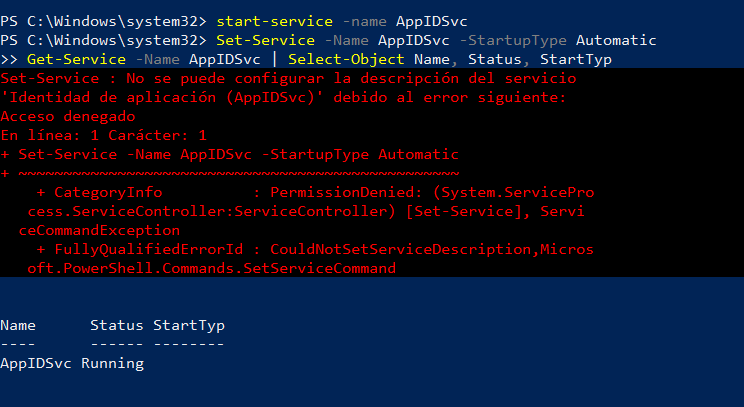

2. Crea el directorio local y los binarios simulados:
   ```powershell
   # Crear directorio del Holonet y clonar herramientas
   New-Item -Path "C:\Holonet" -ItemType Directory -Force
   Copy-Item "C:\Windows\System32\calc.exe" -Destination "C:\Holonet\transmisor_rebelde.exe"
   Copy-Item "C:\Windows\System32\notepad.exe" -Destination "C:\Holonet\consola_imperial.exe"
   ```

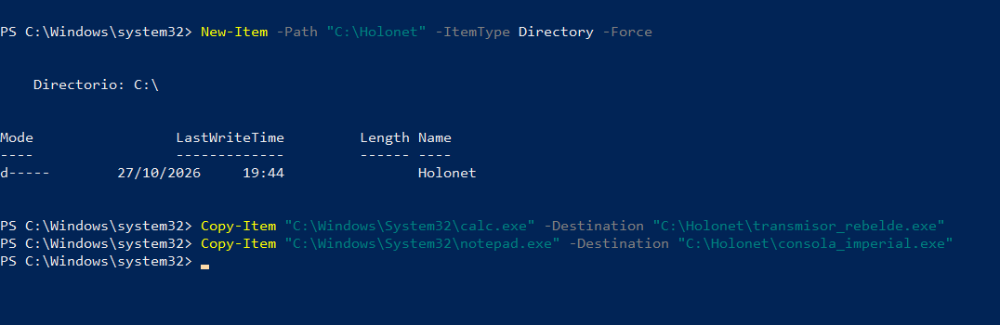

---

##  Fase 2: Configuración de la Directiva Base

>  **Regla Crítica:** En AppLocker, habilitar la exigencia de reglas sin crear las reglas por defecto causará un bloqueo total del sistema operativo (*Deny All* implícito).

### Procedimiento
1. Pulsa `Win + R`, escribe `secpol.msc` y pulsa Enter.
2. Navega a **Directivas de control de aplicaciones** > **AppLocker** > **Reglas ejecutables**.
3. Haz clic derecho en el panel central y pulsa **Crear reglas predeterminadas**.
4. En el panel izquierdo, clic derecho en **AppLocker** > **Propiedades**:
   - Marca **Configurado** en Reglas ejecutables.
   - Selecciona el modo **Exigir reglas**.

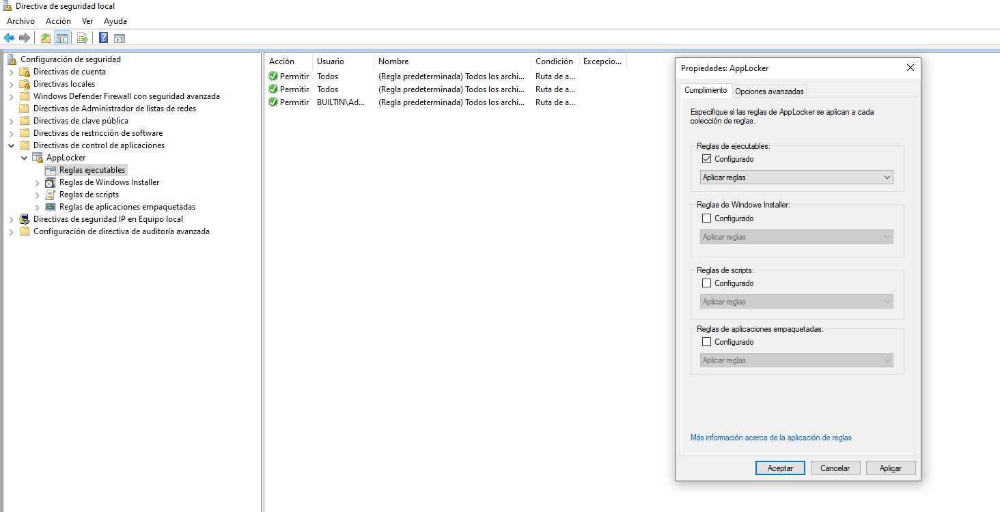

---

##  Fase 3: Lista Negra — Neutralización del Transmisor Rebelde

**Justificación Teórica:**
Se crea una regla explícita de denegación para bloquear una amenaza conocida.

### Procedimiento
1. En Reglas ejecutables, haz clic derecho > **Crear nueva regla**.
2. Permisos: **Acción:** Denegar | **Usuario:** Todos.
3. Condición: Selecciona **Ruta de acceso** > Introduce `C:\Holonet\transmisor_rebelde.exe`.
4. Asigna el nombre *Bloqueo Transmisor Rebelde* y pulsa **Crear**.
5. Aplica la directiva de inmediato ejecutando en consola (cmd o PowerShell):
   ```cmd
   gpupdate /force
   ```

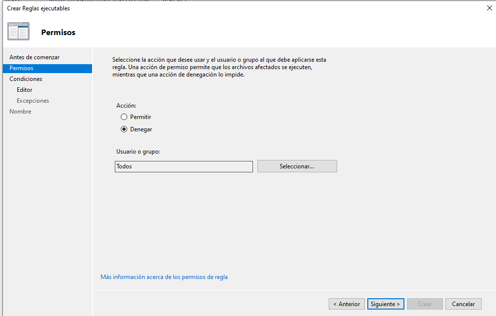
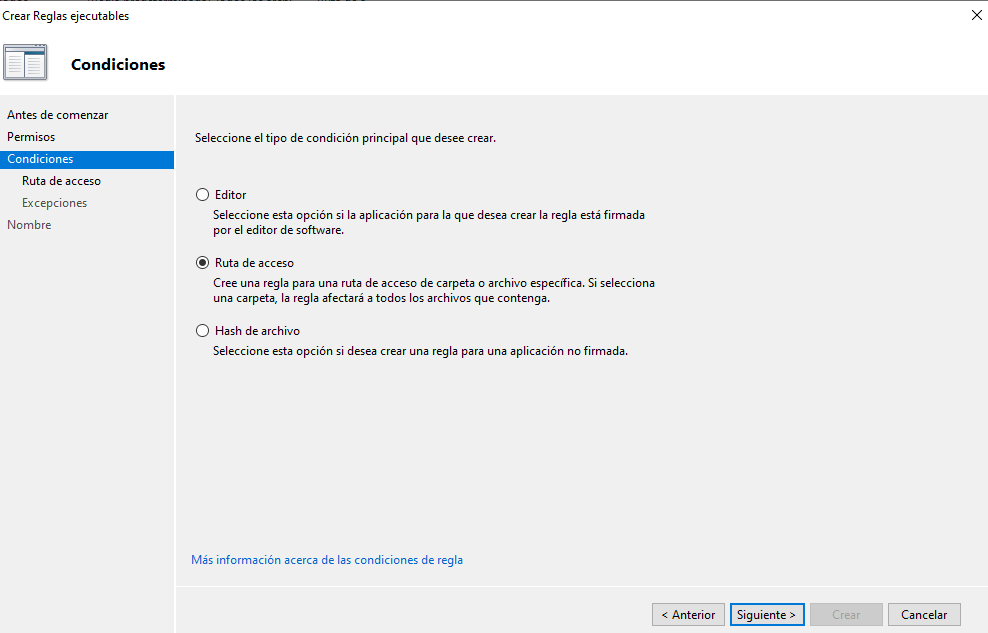
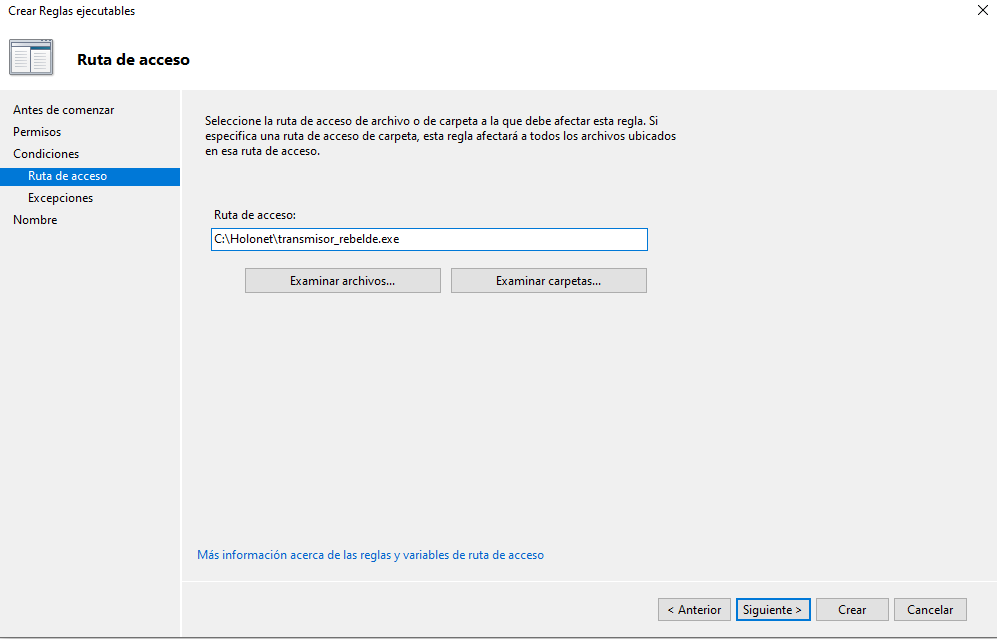
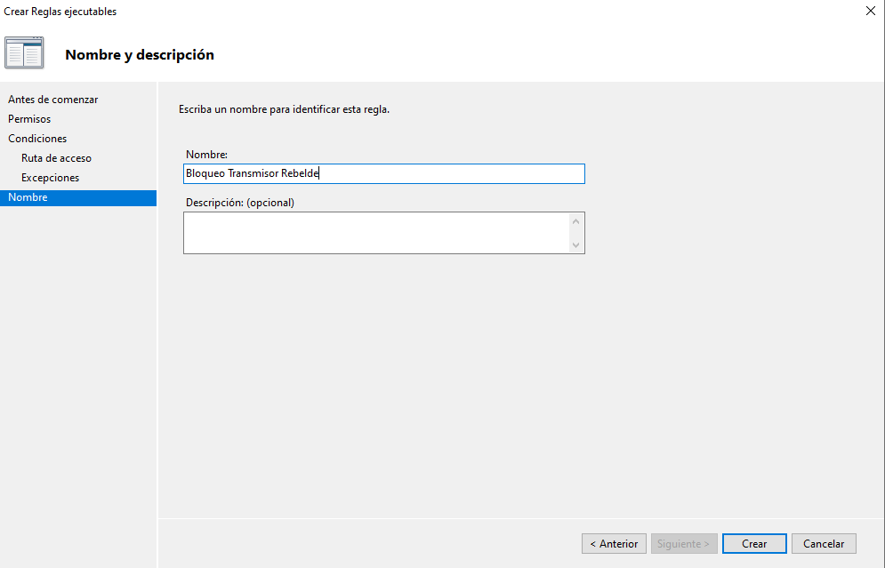
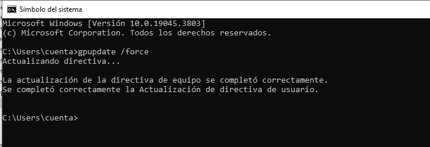
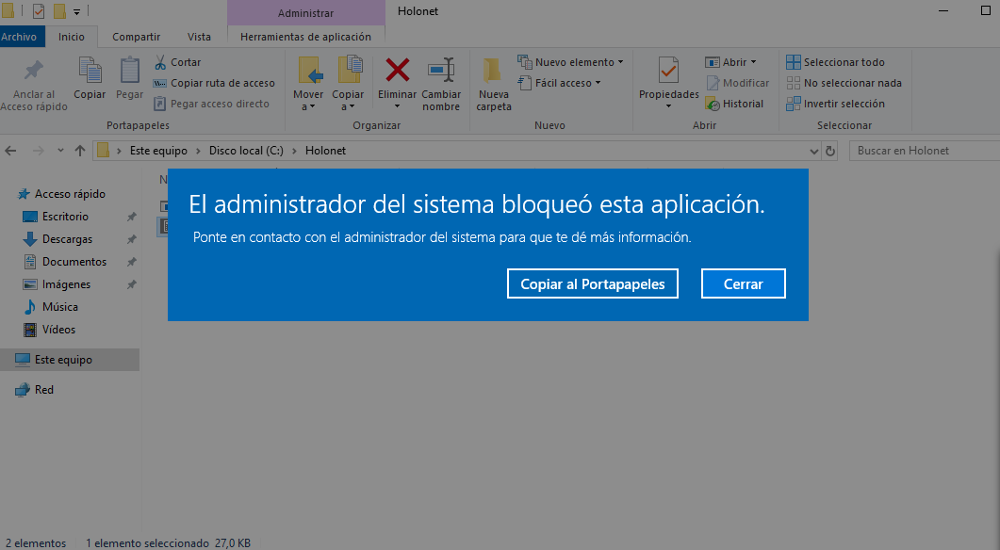

---

##  Fase 4: Lista Blanca — Autorización de la Consola Imperial

**Justificación Teórica:**
Implementación de Zero Trust; solo se autoriza la ejecución del software validado (lista blanca), el resto está bloqueado por defecto.

### Procedimiento
1. Intenta ejecutar `C:\Holonet\consola_imperial.exe` como usuario estándar antes de añadir la regla. Se deniega automáticamente.
2. Crea la regla de autorización por Ruta de acceso (desde la cuenta de Administrador):
   - Clic derecho en Reglas ejecutables > **Crear nueva regla**.
   - Permisos: **Acción:** Permitir | **Usuario:** Todos.
   - Condición: **Ruta de acceso** > `C:\Holonet\consola_imperial.exe`.
3. Aplica los cambios con `gpupdate /force`.
4. **Resultado esperado:** `consola_imperial.exe` se ejecuta correctamente. `transmisor_rebelde.exe` sigue bloqueado.

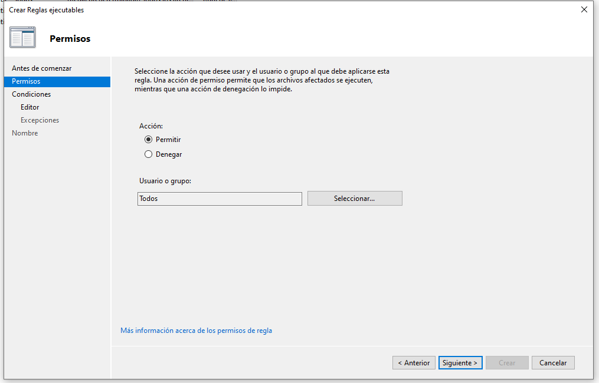
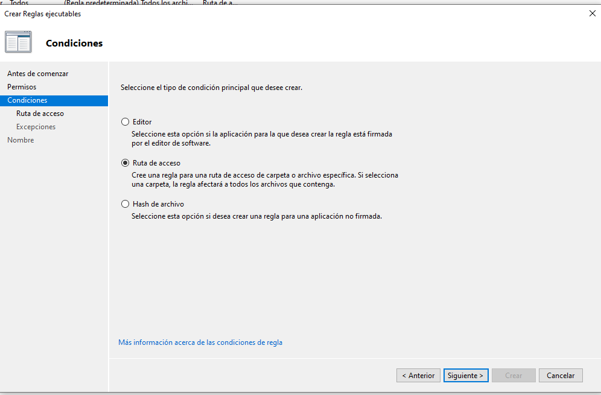
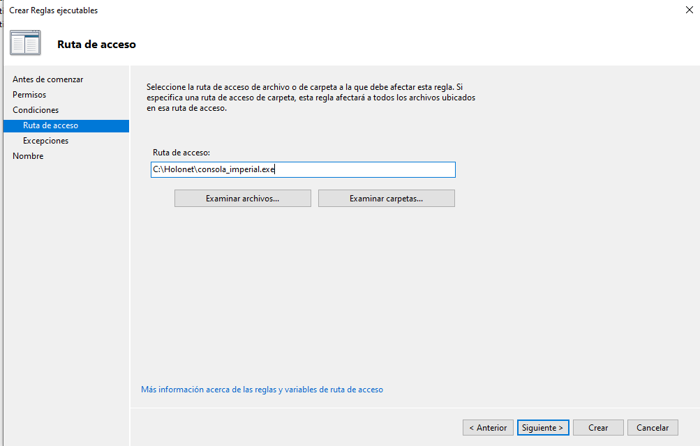


---

## Fase 5: Auditoría y Telemetría en el Visor de Eventos

**Justificación Teórica:**
La telemetría permite a los equipos de defensa rastrear los incidentes (quién y qué archivo intentó saltarse la seguridad).

### Procedimiento
1. Abre el Visor de Eventos (`eventvwr.msc`).
2. Accede a: **Registros de aplicaciones y servicios** > **Microsoft** > **Windows** > **AppLocker** > **EXE and DLL**.
3. Analiza los registros de auditoría:
   - **ID 8002:** Aplicación permitida para su ejecución.
   - **ID 8004:** Aplicación bloqueada por la directiva de AppLocker.
4. Revisa en el evento **8004** la ruta del ejecutable interceptado y el SID del usuario involucrado.

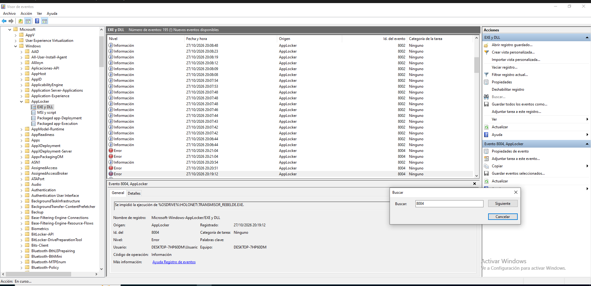

---

##  Desafío Táctico: El Sabotaje del Camuflaje (Evasión de Reglas)

### Paso A: Ataque de Suplantación (Masquerading)
1. Con la cuenta del usuario estándar, haz una copia de `transmisor_rebelde.exe` y renómbrala a `consola_imperial.exe` (reemplazando el archivo original).
2. Ejecuta el archivo renombrado. 
3. **Análisis:** La calculadora se abre a pesar de ser malware.
   * **¿Por qué ocurre?** La directiva permitía la ruta exacta `C:\Holonet\consola_imperial.exe` basándose solo en el nombre/ruta del archivo, sin verificar la integridad o el código interno del mismo.

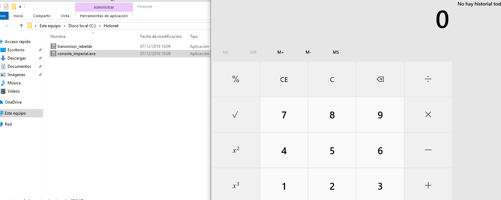

### Paso B: Contramedida Imperial (Regla por Hash Criptográfico)
1. Regresa a `secpol.msc` como Administrador y elimina la regla de permiso por ruta de `consola_imperial.exe`.
2. Crea una nueva regla de tipo **Permitir**, pero en la condición selecciona **Hash de archivo** y apunta al binario original de Bloc de Notas.
3. Aplica con `gpupdate /force` y vuelve a probar con el ejecutable camuflado (desde el usuario estándar).
4. **Análisis:** AppLocker calcula el hash (la huella digital única) del archivo en memoria. Como el hash del malware renombrado no coincide con el del Bloc de notas autorizado, lo bloquea instantáneamente.

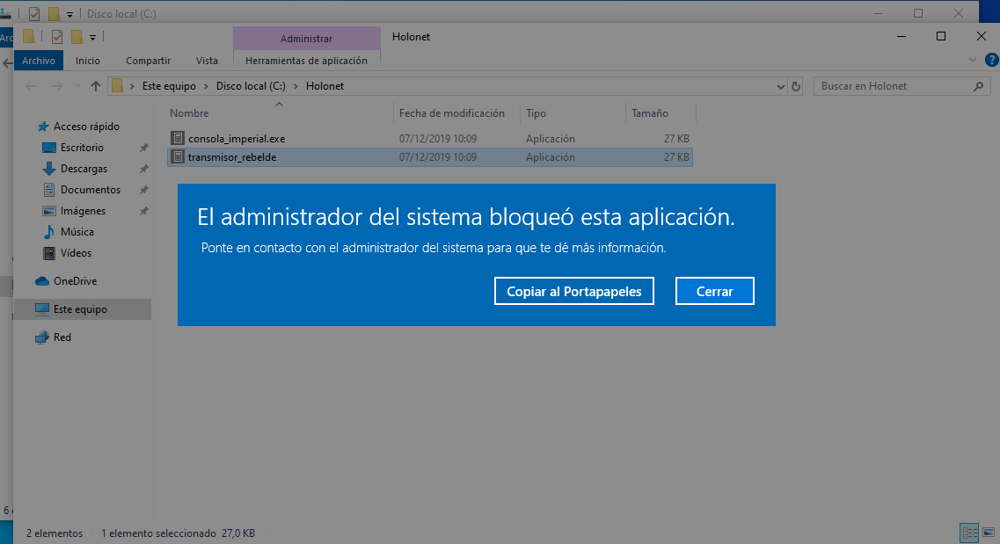